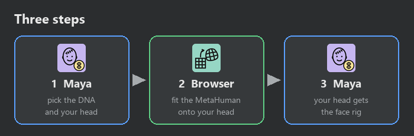
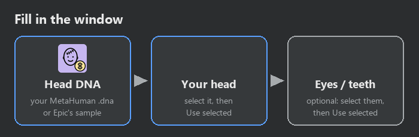
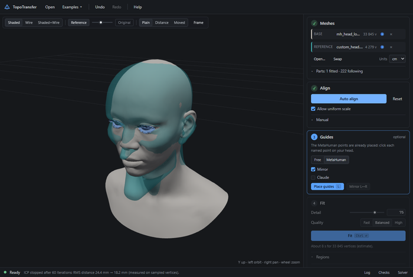
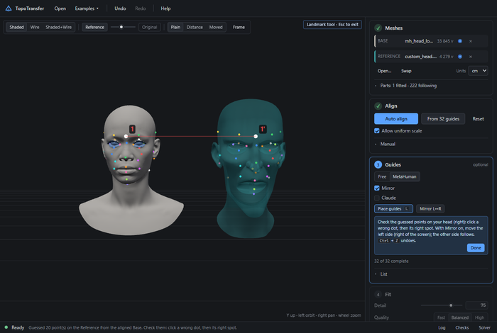
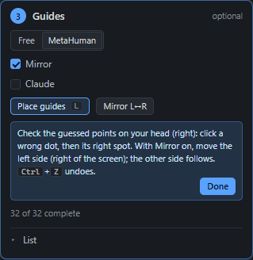
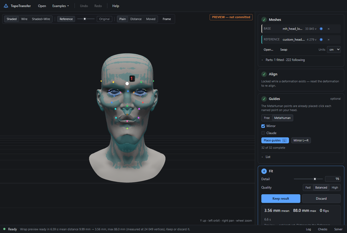
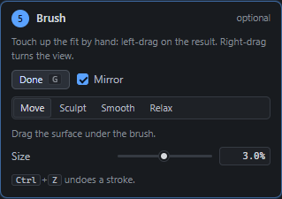
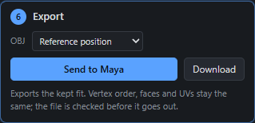
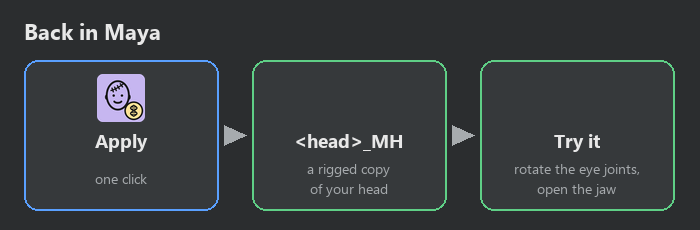

# Meta Mutant in 5 minutes

Give **your own 3D head** the **MetaHuman face rig**: blinking eyes, a jaw that opens, hundreds
of face shapes. Meta Mutant moves the MetaHuman face onto your head, then copies its rig over.

**You need:** Maya 2026, a head model (looking forward, standing up, mouth closed), and a
MetaHuman `.dna` file. No file? Use **Get the sample DNA from Epic...** in the window.

---

## Step 1 · In Maya: fill in the window

Open it from **Mutant-Tools ▸ Misc ▸ Meta Mutant**.

1. **Head DNA**: your MetaHuman file, or Epic's sample.
2. **Your head**: click your head in the scene, then **Use selected**.
3. **Eyes** and **Teeth**: only if your head has them. Select them, then **Use selected**.
4. **Face regions** (optional): open **▸ Face regions**, select the faces of your upper lip, lower lip,
   upper and lower eyelids, mouth bag and eye sockets, one at a time, and press **Use selected** for
   each. Then the lips and eyelids of your head move like the MetaHuman's, without sticking together.

Press **Export and open TopoTransfer**. Your browser opens with both heads in it.

---

## Step 2 · In the browser: fit the MetaHuman onto your head

The MetaHuman is the **Base** (left), your head is the **Reference** (right).

### Align

Press **Auto align**. The MetaHuman jumps onto your head and grows or shrinks to the same size.

### Guides

Guides are dots that say "this spot on the MetaHuman is this spot on my head": nose tip, eye
corners, mouth corners, chin and so on. Same colour = same spot.

Press **Place guides**. The dots on the MetaHuman are already done, and the app makes a first
guess on your head.

Look at the dots on **your head** (right). Is one in the wrong spot? **Click the dot, then click
where it should be.** Made a mistake? **Ctrl + Z**.

* **Mirror** on: only fix the **left side of the face** (the right side of the screen, like
  Mutant Tools guides). The other side copies it.
* **Claude** on: Claude Code can place the dots for you. See [Let Claude place the
  guides](#let-claude-place-the-guides).

Press **Done** when the dots look right.

### Fit

Press **Fit** and wait a few seconds. The MetaHuman now has the shape of your head.

Looks good? **Keep result**. Looks bad? **Discard**, fix some guides, **Fit** again.

### Brush (if you want)

Touch up the result by hand. Press **Brush**, then left-drag on the head (right-drag turns
the view).

| Brush | What it does |
| --- | --- |
| **Move** | drags the skin |
| **Sculpt** | pushes the skin out (hold **Ctrl** to push it in) |
| **Smooth** | smooths bumps and sticks the skin back onto your head |
| **Relax** | evens out the wires without changing the shape |

**Mirror** does both sides at once. **[** and **]** make the brush smaller or bigger.

### Send to Maya

Press **Send to Maya**. Maya gets the result on its own and step 2 in the window turns green.

The button says **not listening**? Maya's link is closed. Open TopoTransfer from Maya again
(Meta Mutant's **Export and open TopoTransfer**, or **Misc ▸ TopoTransfer**): that opens the
link for you. **Download** saves the file instead.

---

## Step 3 · Back in Maya: get the rig

Press **Apply to my head**. You get **`<your head>_MH`**: a copy of your head with the face rig,
right where your head is, and a **face board** next to it. Your own head is not touched.

**Try it:**

* on the face board (laid out like a face), drag **CTRL_C_jaw** down: the mouth opens;
* drag **CTRL_L_eye** and **CTRL_R_eye**: the eyes turn;
* try the brows, cheeks and mouth corners. It works like a MetaHuman's face board, in plain Maya, so
  you can send the scene to anyone with Maya 2026.

Changed something? Press **Apply again**.

---

## Let Claude place the guides

If you use **Claude Code**:

1. Open TopoTransfer from Maya (step 1) and press **Auto align**.
2. In **Guides**, turn **Claude** on.
3. In Claude Code, ask: *"Place the guides on my head in TopoTransfer."*

Claude looks at pictures of your head, puts the dots on it, and you can still move any dot
yourself.

---

## Something looks wrong?

| Problem | Try this |
| --- | --- |
| The MetaHuman is far from my head | **Auto align** again; check your head stands up and looks forward |
| The face is twisted or melted | fix the guides near that spot, then **Fit** again |
| A small bump or dent | **Brush** ▸ **Smooth** |
| The eyes or teeth are off | pick them again in step 1, then **Apply again** |
| **Send to Maya** is grey | open TopoTransfer from Maya again (see above) |

Want all the details? Open **README.md** in this folder.
